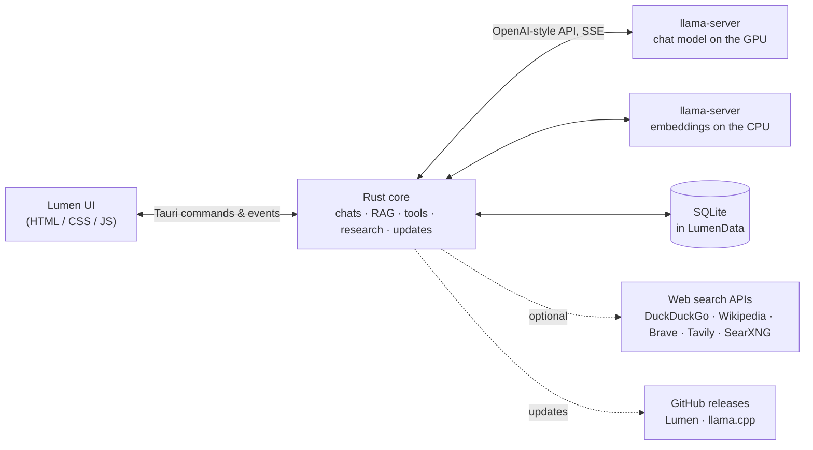

<div align="center">


# Lumen

**Chat with local AI models on your own computer: one program, no cloud, no setup to babysit.**

Lumen downloads the official llama.cpp engine for you, runs your models on your GPU, reads and edits your projects,
searches the web when you ask it to, and keeps every chat on your machine.


[](https://github.com/Akulav/local-ai-ui/releases/latest)
[](https://github.com/Akulav/local-ai-ui/actions/workflows/ci.yml)

[**Download**](https://github.com/Akulav/local-ai-ui/releases/latest) ·
[Quick start](#-quick-start) ·
[Features](#-features) ·
[Building](#%EF%B8%8F-building-from-source) ·
[Changelog](CHANGELOG.md)

</div>

---

## Contents

- [Why it's different](#-why-its-different) · [Features](#-features)
- [Quick start](#-quick-start) · [What you need](#-what-you-need)
- [Installing, updating and uninstalling](#-installing-updating-and-uninstalling)
- [The tray and the command line](#-the-tray-and-the-command-line) · [How it works](#%EF%B8%8F-how-it-works)
- [Models](#-models) · [Settings](#%EF%B8%8F-settings) · [Privacy and safety](#-privacy-and-safety)
- [Building from source](#%EF%B8%8F-building-from-source) · [Versions and releases](#%EF%B8%8F-versions-and-releases) · [Tests](#-tests)
- [Project layout](#%EF%B8%8F-project-layout) · [Troubleshooting](#-troubleshooting) · [License](#-license)

---

## ✨ Why it's different

|  |  |
|---|---|
| 🏠 **Local only** | The chat model, the embeddings for project search and every chat run on your computer. Web search is optional, off by default, and goes through official APIs only. |
| 📦 **One program** | A setup wizard on Windows, an app in a disk image on a Mac, a single file on Linux. It fetches the llama.cpp engine itself; no Python, no Docker, no terminal. |
| 🧹 **Tidy** | Models, chats and the engine live in one `LumenData` folder. The engine stops with Lumen, even if Lumen crashes (a job object on Windows, the parent-death signal on Linux). |
| 🔄 **Keeps itself current** | Checks GitHub for a new Lumen and a new llama.cpp. One click downloads, checks the checksum, installs and restarts. |
| 🛠️ **Works on your code** | Link a folder: Lumen indexes it, searches it, reviews it and edits it, and every change is a diff card with **Undo**. |

## 🎀 Features

| Area | What it does |
|---|---|
| **Chats** | Saved in SQLite, titled automatically, pinned, searched (titles and messages), exported as Markdown. A **Think** toggle shows the model's reasoning live. Edit and regenerate any turn. |
| **Context** | A live context meter. Older turns are summarised automatically, a byte-stable prompt keeps llama.cpp's cache warm, long tool sessions are trimmed to fit, and each chat can set its own window size. |
| **Projects** | Link a folder: code, text, PDF and DOCX are indexed incrementally (`.gitignore`-aware). Hybrid search: BM25 that ignores diacritics and splits camelCase, plus Qwen3-Embedding vectors on the CPU, fused with Reciprocal Rank Fusion. |
| **Code tools** | The model can `grep`, outline files, find symbols, compare files, read `git status` / `git diff`, edit and write files (diff cards with Undo), audit a whole codebase in batches, and run your tests or linter after you allow the command. |
| **Code review** | Findings with file, line, severity, problem and fix, sorted by severity, copyable as Markdown. |
| **Web & research** | A **Web** toggle lets the model search and read pages. **Deep research** plans, searches, reads and reflects for up to three rounds, then writes a cited report. |
| **Models** | Curated picks for 16 GB cards, any GGUF from Hugging Face, resumable downloads, load / unload / switch on the fly, automatic context size that fits the free VRAM. |
| **Engine telemetry** | GPU and CPU load, VRAM / RAM, tokens/s live and on average, prompt speed and the server's own counters. Nothing leaves the computer. |
| **Comfort** | Close to the tray, unload the model after idle time, custom instructions, keyboard shortcuts, English and Romanian. |

## 🚀 Quick start

1. **Download** the file for your system from the [latest release](https://github.com/Akulav/local-ai-ui/releases/latest)
   and install it (see [below](#-installing-updating-and-uninstalling)).
2. **Start Lumen.** It downloads the llama.cpp engine (about 100 MB) on its own.
3. **Pick a model** in **Models**. On a 16 GB card the recommended **Qwen3.8 27B UD-IQ4_XS** (13.3 GB) fits fully in VRAM.
4. **Chat**, or link a folder as a **Project** to talk about your own files.

> [!TIP]
> Web search works without a key (DuckDuckGo instant answers + Wikipedia). For full web results add a free
> [Brave Search API](https://brave.com/search/api/) key (or Tavily, or your own SearXNG) in **Settings → Web search**.

## 🧰 What you need

| | Minimum | Comfortable |
|---|---|---|
| **GPU** | 8 GB VRAM, AMD / NVIDIA / Intel (a 7–9B model), or CPU only | 16 GB VRAM (a 27B model), e.g. AMD RX 9070 XT or NVIDIA RTX 4080 |
| **RAM** | 16 GB | 32 GB |
| **Disk** | ~10 GB (engine + one small model) | more for bigger models |
| **OS** | Windows 10/11 x64, a Linux desktop (x86-64, WebKitGTK 4.1), or macOS 11+ on Apple Silicon | |
| **Network** | Internet for the first downloads | |

## 📦 Installing, updating and uninstalling

One file per system – the same file installs Lumen and later updates it. No disk image, zip or MSI.

| System | File | Where Lumen lives | Shortcuts |
|---|---|---|---|
| Windows | `Lumen-setup.exe`: a wizard (English / Romanian) with a license page, a folder you can change and a *desktop shortcut* choice; per user, no administrator rights | `%LOCALAPPDATA%\Lumen` (data in `LumenData` inside it) | Start menu, desktop, *Settings → Apps* |
| macOS | `lumen-macos-arm64`: right-click it → *Open* (or `chmod +x` it and run it in Terminal); on its first start it builds `Lumen.app` and opens it | `~/Applications/Lumen.app` (an older `/Applications/Lumen.app` is kept and updated); data in `~/Library/Application Support/Lumen` | Applications (Launchpad, Spotlight) |
| Linux | `lumen-linux-x64`: `chmod +x` it and run it; it installs itself on its first start | `~/.local/share/lumen` (data in `LumenData` inside it) | app menu, desktop |

**Updating.** Lumen checks for a new version 20 seconds after it starts and every 6 hours (Settings → About can turn
that off), and whenever you press **Check for updates** (sidebar, Settings → About, or the tray menu). When there is
one, an **Update** entry appears in the sidebar and the tray menu. Updating downloads the release's file for your
system, checks it against the release's `SHA256SUMS.txt` (a mismatch changes nothing) and then:

- **Windows:** runs `Lumen-setup.exe` on your install folder: a progress window, no questions. It removes the old
  version (your data stays), installs the new one and starts it.
- **Linux / macOS:** swaps the program in place (macOS: inside Lumen.app, which is re-signed) and starts it again.

The llama.cpp engine is offered the same way when a newer build is out; the model is reloaded afterwards.
Installs made by the old installer (Lumen 0.8 and earlier) are taken over by the new setup in the same folder.

| Written by an update | Never touched |
|---|---|
| The program (and on Windows its shortcuts and Apps entry) | `LumenData`: models, chats, projects, settings, logs, the engine |

**Uninstalling.**

| System | How |
|---|---|
| Windows | *Settings → Apps → Lumen → Uninstall*, or Start menu → *Uninstall Lumen*. It asks whether to delete `LumenData` too (default: keep). |
| macOS | `~/Applications/Lumen.app/Contents/MacOS/lumen --uninstall` (add `--delete-data` to remove the data too), or drag Lumen from Applications to the Bin and delete `~/Library/Application Support/Lumen`. |
| Linux | `~/.local/share/lumen/lumen --uninstall` (add `--delete-data` to remove the data too). |

## 💗 The tray and the command line

Closing the window keeps Lumen and the loaded model running in the tray (menu bar on macOS); the tray menu has
**Open**, **Update** (when there is one), **Check for updates**, **Unload model** and **Quit**.
Settings → App → *Close to tray* turns that off. On a Linux desktop without a tray, closing the window quits.

| Option | |
|---|---|
| `--version` | print the version and quit |
| `--here` | Linux / macOS: run where the program is instead of installing it |
| `--uninstall` [`--delete-data`] | Linux: remove the program and its menu entries; macOS: remove Lumen.app (and, with `--delete-data`, the data) |

## 🏗️ How it works



- **Engine.** Lumen downloads llama.cpp's official build for your system (Windows and Linux: Vulkan for any GPU,
  CUDA for NVIDIA, ROCm for AMD, or CPU; macOS: Metal) into `LumenData/runtime` and starts `llama-server` with `--fit`, which picks GPU
  layers and the largest context that fits your free VRAM. Its RAM prompt cache is sized from the memory that is free
  when it starts.
- **A turn.** The prompt is the system prompt, a summary of compressed turns and the recent messages. Project chats
  add auto-retrieved excerpts; the model may then call tools (files, git, search, web), each result goes back to it,
  for up to 24 rounds. Titles and summaries are made by the same model.

## 🧠 Models

Models are GGUF files in `LumenData/models`. **Models** shows curated picks for 16 GB cards (with a "fits in VRAM"
tag computed for your GPU), searches Hugging Face for any GGUF repository, and downloads with resume. Load, unload,
switch and delete at any time; the last model loads at start (optional). Small model for testing: any ~1–2 GB GGUF.

## ⚙️ Settings

| Group | What you can set |
|---|---|
| **Language** | interface (English / Romanian), reply language (auto / English / Romanian) |
| **Engine** | GPU backend, llama.cpp version and update, context size, KV cache precision, MoE layers on the CPU, unload after idle time |
| **Chat** | custom instructions, temperature, auto-compress threshold, Think by default, semantic project search |
| **Web search** | DuckDuckGo (default, no key), Wikipedia, Brave, Tavily, SearXNG |
| **App** | close to tray, load the last model on start, data folder, quit |
| **About** | version, **Check for updates** / **Update**, automatic checks on or off, server log |

## 🔒 Privacy and safety

- Chats, files, models and telemetry stay on your computer. Lumen talks to the internet only to download the engine
  and models, to check for updates on GitHub, to read a link you gave it (in your message or in a project file it
  read, and pages under that link), and - when you turn Web on - to search through official APIs and read any page.
- File tools are sandboxed to the project folder; every write keeps a backup so the diff card can undo it.
- Commands (`run_command`) and git only run after you allow them in the chat.
- Updates install only files whose SHA-256 matches the release's `SHA256SUMS.txt`, from this repository's releases.

## 🛠️ Building from source

**Windows:** double-click **`run.bat`**. It installs whatever is missing with `winget` (Node.js, Rust, the Visual
Studio C++ Build Tools - those ask for administrator rights once - and Inno Setup), builds the program and the setup,
copies them to `dist\Lumen\Lumen.exe` and `dist\Lumen-setup.exe`, and starts Lumen.

| Command | What it does |
|---|---|
| `run.bat` | install tools if needed → build the program and the setup → copy to `dist\` → launch |
| `run.bat build` | the same, without launching |
| `run.bat quick` | the program only (no setup), then launch |
| `run.bat dev` | dev mode (`tauri dev`, the UI reloads as you edit it) |
| `run.bat clean` | delete `target/` and `node_modules/` (keeps `dist\Lumen\LumenData`) |

**By hand, any system:**

```bash
npm ci
npx tauri build --no-bundle      # → src-tauri/target/release/lumen(.exe)
```

Linux needs the WebKitGTK and app-indicator development packages first
(`libwebkit2gtk-4.1-dev libgtk-3-dev libayatana-appindicator3-dev librsvg2-dev libxdo-dev` on Ubuntu).
A copy built on your computer never replaces itself with a download.

## 🏷️ Versions and releases

`package.json` holds the version (Tauri reads it; `src-tauri/Cargo.toml` must match). Changes are noted under
`[Unreleased]` in [CHANGELOG.md](CHANGELOG.md), then:

```bash
npm run version:bump          # patch, or: minor | major | 1.2.3 - turns [Unreleased] into the new version
git commit -am "Release vX.Y.Z: what changed"
npm run release               # checks everything and pushes main (pushing from GitHub Desktop works too)
```

A push to `main` with a version that has no release yet makes the **Release** workflow run the tests, build Lumen on
GitHub's Windows, Linux and macOS runners, create the tag `vX.Y.Z` and publish the release:

| File | |
|---|---|
| `Lumen-setup.exe` | Windows setup wizard; also what an update runs |
| `lumen-linux-x64` | the Linux program: installs itself on its first start; also what an update downloads |
| `lumen-macos-arm64` | the macOS program: builds Lumen.app on its first start; also what an update downloads |
| `SHA256SUMS.txt` | checksums of the three |

The release notes are the version's section of the changelog. The **CI** workflow checks every push and pull request on
all three systems (versions agree, UI scripts parse, clippy without warnings, tests, the setup compiles).

## 🧪 Tests

```bash
cd src-tauri
cargo test                       # unit tests (parsing, updates, prompt cache, tools, …)
cargo test -- --ignored          # also the live ones: real update pipeline against the latest release, …
```

`live_llama_server_telemetry` needs `LUMEN_TEST_SERVER` (a `llama-server`) and `LUMEN_TEST_MODEL` (a small GGUF);
`live_windows_update` needs `LUMEN_TEST_SETUP` and `LUMEN_TEST_DIR` (a test build of the setup and its folder).

## 🗂️ Project layout

```
run.bat, scripts/            one-click build, version bump, release checks, release notes, setup pictures
.github/workflows/           ci.yml (checks on 3 systems), release.yml (tests → 3 builds → tag + release)
ui/                          the interface: index.html, styles.css, app.js, i18n.js (English / Romanian), vendor/
src-tauri/installer/         lumen.iss + Romanian.isl (Windows setup), Info.plist (macOS app, built in), wizard pictures
src-tauri/src/               the Rust core (see CLAUDE.md for a file-by-file map)
```

## 🩺 Troubleshooting

| Problem | What to do |
|---|---|
| **"bad allocation"** / "The model server ran out of memory" | The engine could not get memory (RAM + page file) for a request. Close programs that use a lot of memory (another AI app, a game), pick a smaller context size, or let Windows manage a larger page file. Since 0.9 Lumen sizes the engine's RAM prompt cache from the free memory, which removes the usual cause. |
| The model doesn't load / "llama-server exited" | Settings → Server logs (also `LumenData/logs/lumen.log`). Try a smaller model or context size, or another GPU backend. |
| Slow replies | Check the engine panel (chip icon in the status bar): if VRAM is full, part of the model runs in RAM. Use a smaller quant or context. |
| macOS: "lumen-macos-arm64 can't be opened" on first start | Right-click the file → *Open*, or in Terminal: `xattr -d com.apple.quarantine lumen-macos-arm64` (Lumen is signed ad hoc, not by a paid Apple certificate). The Lumen.app it builds opens normally afterwards. |
| Linux: no tray icon | Install your desktop's app-indicator extension (e.g. *AppIndicator* on GNOME); without it, closing the window quits Lumen. |

## 📄 License

Lumen is **source-available**, not open source: you may use the releases, read the code and modify it privately,
but not redistribute it or use it commercially. See [LICENSE](LICENSE). Third-party components (llama.cpp, models,
libraries) keep their own licenses.

---

<div align="center">


**Made by [Akulav](https://github.com/Akulav)**

</div>
