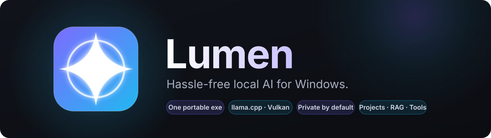
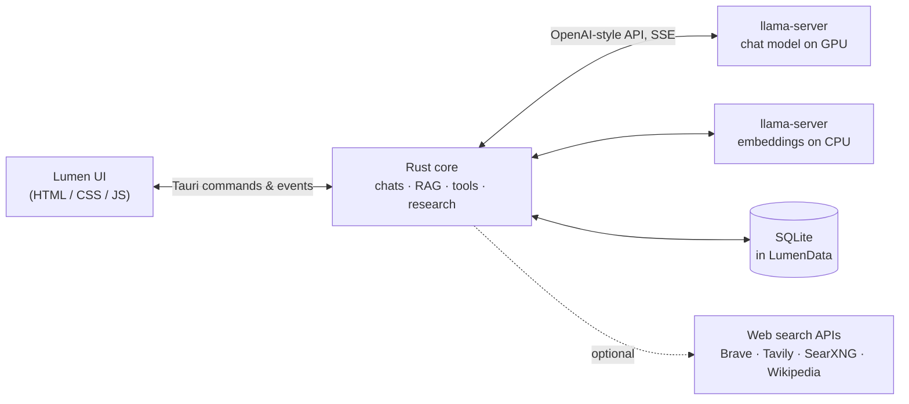

<div align="center">



<br>

**Chat with local LLMs on your own GPU. One portable exe, no setup, no cloud.**

[](https://github.com/Akulav/local-ai-ui/releases)
[](https://github.com/Akulav/local-ai-ui/actions/workflows/ci.yml)
[](#-download)
[](https://tauri.app)
[](https://github.com/ggml-org/llama.cpp)
[](LICENSE)

[**Download**](https://github.com/Akulav/local-ai-ui/releases/latest) ·
[Features](#-features) ·
[Getting started](#-getting-started) ·
[Building](#%EF%B8%8F-building-from-source) ·
[Changelog](CHANGELOG.md)

</div>

---

## ✨ Why Lumen

Lumen is a single Windows app for running local language models. On first launch it downloads the official
**llama.cpp** build (Vulkan by default, which is fast on AMD RDNA4 cards like the RX 9070 XT) and runs
`llama-server` for you. No Python, no Docker, no terminal.

- **Self-contained.** Runtime, models and chats live in a `LumenData\` folder next to the exe. Copy the folder and it all comes along.
- **Tidy.** The server is bound to a Windows job object, so it shuts down with Lumen, even if Lumen crashes.
- **Private by default.** Chats, files and inference stay on your machine. The web tools are optional and only run when you turn them on.

## 🧩 Features

<table>
<tr>
<td width="50%" valign="top">

### 💬 Chats
Saved in SQLite, titled automatically, with pinning, editing and regeneration.
A **Thinking** toggle shows the model's reasoning live in an expandable panel.

</td>
<td width="50%" valign="top">

### 📁 Projects
Link a folder and Lumen indexes code, text, PDF and DOCX, incrementally and `.gitignore`-aware.
The model can search, read, edit and write files. Every change appears as a coloured diff card with **Undo**.

</td>
</tr>
<tr>
<td valign="top">

### 🔎 Hybrid RAG
BM25 that ignores diacritics and splits camelCase, plus Qwen3-Embedding vectors on the CPU, fused with
Reciprocal Rank Fusion. Your GPU stays free for the chat model.

</td>
<td valign="top">

### 🌐 Web & Deep research
A **Web** toggle lets the model search and read pages. **Deep research** plans, searches, reads and reflects
for up to 3 rounds, then writes a report with cited sources.

</td>
</tr>
<tr>
<td valign="top">

### 🧠 Context management
A live context meter. Older turns are compressed into a summary automatically, and a byte-stable prefix
keeps llama.cpp's prompt cache warm. Each chat can set its own window size.

</td>
<td valign="top">

### 📦 Model manager
Curated picks for 16 GB cards, any GGUF from Hugging Face search, resumable downloads, and
load / unload / delete / switch on the fly.

</td>
</tr>
<tr>
<td valign="top">

### 📊 Metrics
Live and average tokens/s, plus the VRAM and RAM used by the `llama-server` process.

</td>
<td valign="top">

### 🪟 Feels native
Closing the window keeps Lumen in the tray (Open / Unload model / Quit).
The UI is available in **English** and **Romanian**.

</td>
</tr>
</table>

## 🚀 Getting started

### 📥 Download

Grab the latest build from [**Releases**](https://github.com/Akulav/local-ai-ui/releases/latest):

| Package | Best for |
|---|---|
| `Lumen-vX.Y.Z-windows-x64-portable.zip` | Unzip anywhere (even a USB drive) and run `Lumen.exe` |
| `Lumen_X.Y.Z_x64-setup.exe` | Per-user installer with Start menu entry, no admin rights needed |
| `SHA256SUMS.txt` | Checksums to verify your download |

### ▶️ First run

1. Launch `Lumen.exe`. It downloads the llama.cpp runtime on its own.
2. Open the **Model manager** and pick a model. The recommended default for a 16 GB card is
   **Qwen3.8 27B UD-IQ4_XS** (13.3 GB, fits fully in VRAM).
3. Start chatting, or link a folder as a **Project** to talk about your own files.

> [!TIP]
> Web search uses official APIs. Wikipedia works without a key. For full web results, add a free
> [Brave Search API](https://brave.com/search/api/) key (or Tavily, or your own SearXNG) in **Settings → Web search**.

### 💻 Recommended hardware

| | Tuned for | Also works |
|---|---|---|
| **GPU** | AMD RX 9070 XT, 16 GB (Vulkan) | Other Vulkan GPUs, ROCm, or CPU-only with smaller models |
| **RAM** | 32 GB | Less, with smaller models |
| **OS** | Windows 11 | Windows 10 (x64) |

## 🏗️ How it works



## 🛠️ Building from source

Double-click **`run.bat`**. It checks for Node.js, Rust and the Visual Studio C++ Build Tools, installs any that
are missing with `winget` (the Build Tools ask for admin rights once), builds the release exe, copies it to
`dist\Lumen\Lumen.exe` and launches it.

| Command | What it does |
|---|---|
| `run.bat` | Install tools if needed → build → copy to `dist\Lumen` → launch |
| `run.bat build` | Same, without launching |
| `run.bat dev` | Dev mode (`tauri dev`) |
| `run.bat clean` | Delete `target/` and `node_modules/` (keeps your models and chats) |

Prefer doing it by hand?

```bash
npm ci
npx tauri build --no-bundle
```

The exe ends up in `src-tauri\target\release\lumen.exe`.

<details>
<summary><b>📦 Versioning & releases</b></summary>

<br>

`package.json` holds the version (Tauri reads it, and it is synced into `Cargo.toml`). Note changes under
`[Unreleased]` in [CHANGELOG.md](CHANGELOG.md) as you go, then:

```bash
npm run version:bump            # patch, or: minor | major | 1.2.3 (turns [Unreleased] into the new version)
git commit -am "Release vX.Y.Z"
npm run release                 # checks everything, tags vX.Y.Z and pushes
```

Pushing the tag triggers the **Release** workflow. It builds on GitHub's Windows runners and publishes the
release with the portable zip, the installer, SHA256 checksums and the changelog entry as notes.
The **CI** workflow checks every push and pull request.

</details>

## 📄 License

Lumen is **source-available**, not open source. You can use the releases, read the code and modify it privately,
but you can't redistribute it or use it commercially. See [LICENSE](LICENSE) for the full terms.
Third-party components (llama.cpp, models, libraries) keep their own licenses.

---

<div align="center">


Made with care by **[Akulav](https://github.com/Akulav)**

</div>
